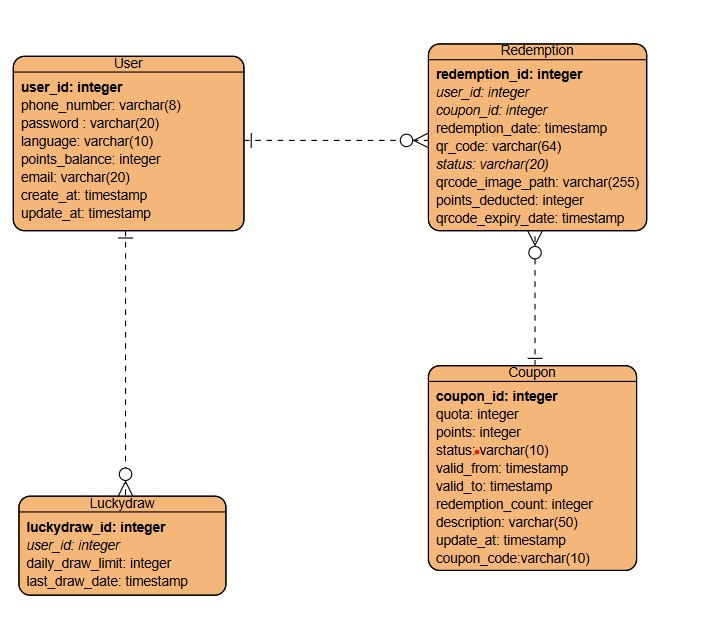

# Redemption Campaign API

> **Status:** 🚧 Work in Progress

Redemption Campaign is a redemption activity platform for managing user registration, verification, daily lucky draws, coupons, and coupon redemptions. It supports multi-language content for English ('en') and Chinese ('zh').

The backend API and Postman collection are available for testing. The frontend design flow, web pages, and complete user journey are still being developed.

## Features

- User registration via SMS or email verification
- User login with JWT authentication
- SMS and email verification codes
- Daily lucky draw with points rewards
- Coupon listing with multi-language support
- Coupon redemption with QR code generation
- Admin CMS endpoint for updating coupons
- Postman API collection for testing

## Tech Stack

- **Frontend:** React
- **Database:** Microsoft SQL Server (MSSQL)
- **Authentication:** JWT Bearer Token
- **API Testing:** Postman
- **Database Design:** ERD Diagram

## API Overview

Base URL:

```http
http://localhost:3000/api/v1
```

Protected endpoints require a JWT token in the `Authorization` header:

```http
Authorization: Bearer <user_token>
```

Admin endpoints require an admin JWT token:

```http
Authorization: Bearer <admin_token>
```

## API Endpoints

| Method | Endpoint | Description | Authentication |
|---|---|---|---|
| POST | `/api/v1/verification/sms` | Send SMS verification code | No |
| POST | `/api/v1/verification/email` | Send email verification code | No |
| POST | `/api/v1/register` | Register a user using SMS or email verification | No |
| POST | `/api/v1/login` | Log in and receive a JWT token | No |
| POST | `/api/v1/luckydraw` | Participate in the daily lucky draw | User |
| GET | `/api/v1/coupons` | List available coupons | No |
| POST | `/api/v1/coupons/redeem` | Redeem a coupon using points | User |
| PUT | `/api/v1/admin/coupons/:id` | Update coupon details in CMS | Admin |

## Authentication

After successful login, the API returns a JWT token:

```json
{
  "status": "success",
  "user_id": 1,
  "points_balance": 0,
  "language": "en",
  "token": "<jwt_token>"
}
```

Use this token for protected endpoints:

```http
Authorization: Bearer <jwt_token>
```

## User Registration

### Send SMS Verification Code

```http
POST /api/v1/verification/sms
Content-Type: multipart/form-data
```

| Field | Type | Required | Description |
|---|---|---|---|
| `phone_number` | text | Yes | User phone number |

### Register with SMS

```http
POST /api/v1/register
Content-Type: multipart/form-data
```

| Field | Type | Required | Description |
|---|---|---|---|
| `phone_number` | text | Yes | User phone number |
| `password` | text | Yes | User password |
| `sms_code` | text | Yes | SMS verification code |
| `email` | text | Yes | User email |
| `language` | text | Yes | Preferred language: `en` or `zh` |
| `method` | text | Yes | Registration method: `sms` |

### Register with Email

```http
POST /api/v1/register
Content-Type: multipart/form-data
```

| Field | Type | Required | Description |
|---|---|---|---|
| `phone_number` | text | Yes | User phone number |
| `password` | text | Yes | User password |
| `email_code` | text | Yes | Email verification code |
| `email` | text | Yes | User email |
| `language` | text | Yes | Preferred language: `en` or `zh` |
| `method` | text | Yes | Registration method: `email` |

## User Login

```http
POST /api/v1/login
Content-Type: multipart/form-data
```

| Field | Type | Required | Description |
|---|---|---|---|
| `phone_number` | text | Yes | Registered phone number |
| `password` | text | Yes | User password |

## Daily Lucky Draw

```http
POST /api/v1/luckydraw
Authorization: Bearer <user_token>
Content-Type: multipart/form-data
```

| Field | Type | Required | Description |
|---|---|---|---|
| `user_id` | text | Yes | ID of the participating user |

Each user can participate once per day. A successful draw returns the earned points and updated points balance.

## Coupons

### List Coupons

```http
GET /api/v1/coupons?language=en
```

Supported languages:

- `en`: English
- `zh`: Chinese

### Redeem Coupon

```http
POST /api/v1/coupons/redeem
Authorization: Bearer <user_token>
Content-Type: multipart/form-data
```

| Field | Type | Required | Description |
|---|---|---|---|
| `user_id` | text | Yes | ID of the redeeming user |
| `coupon_id` | text | Yes | ID of the coupon to redeem |

A successful redemption returns a redemption ID, QR code, QR code expiry date, deducted points, and updated points balance.

## Admin Coupon Management

```http
PUT /api/v1/admin/coupons/:id
Authorization: Bearer <admin_token>
Content-Type: multipart/form-data
```

| Field | Type | Required | Description |
|---|---|---|---|
| `quota` | text | Yes | Available coupon quota |
| `points` | text | Yes | Points required for redemption |
| `status` | text | Yes | Coupon status, e.g. `active` |
| `valid_from` | text | Yes | Coupon validity start date |
| `valid_to` | text | Yes | Coupon validity end date |
| `description` | text | Yes | Coupon description |

## Postman Testing

1. Open Postman.
2. Import the Postman collection:
  
   Redemption Campaign API.postman_collection.json
   
3. Set the `base_url` variable:
  
   http://localhost:3000
   
4. Log in as a normal user and copy the returned JWT token.
5. Set the collection variable `user_token` to the copied token.
6. Log in as an administrator and copy the admin JWT token.
7. Set the collection variable `admin_token` to the admin token.
8. Run the requests in the collection.

Recommended testing flow:

1. Send an SMS or email verification code.
2. Register a new user.
3. Log in and copy the returned JWT token.
4. Set `user_token` in Postman.
5. Call the daily lucky draw endpoint.
6. List available coupons.
7. Redeem a coupon.
8. Use an admin token to update a coupon.

## Error Responses

The following error responses are included in the Postman collection. The full error response documentation is not yet complete.

| Status Code | Example Message |
|---|---|
| 400 | `Invalid SMS verification code` |
| 400 | `Invalid email verification code` |
| 400 | `Invalid phone number format` |
| 400 | `Invalid email format` |
| 400 | `Insufficient points to redeem this coupon` |
| 401 | `Invalid or missing authentication token` |
| 403 | `User has already participated in the lucky draw today` |

## Database

The database is designed using an ERD diagram and implemented in MSSQL.

Main entities include:

- Users
- Verification codes
- Lucky draw records
- Coupons
- Redemptions

ERD diagram:



## Getting Started

### Prerequisites

- Node.js 18+
- npm
- Microsoft SQL Server
- SQL Server Management Studio (SSMS) or Azure Data Studio
- Postman

### Installation

```bash
git clone [https://github.com/chanleo111/redemption-campaign.git](https://github.com/chanleo111/redemption-campaign.git)
cd redemption-campaign
npm install
```

### Environment Variables

Create a `.env` file in the project root:

```env
PORT=3000
DB_SERVER=localhost
DB_DATABASE=RedemptionCampaign
DB_USER=your_database_username
DB_PASSWORD=your_database_password
JWT_SECRET=your_jwt_secret
```

Add `.env` to `.gitignore` before committing:

```gitignore
.env
.env.local
```

### Run Locally

```bash
npm start
```

The API will be available at:

```http
http://localhost:3000/api/v1
```

## Roadmap

- [ ] Complete user authentication and authorization
- [ ] Add coupon creation and deletion endpoints
- [ ] Add redemption history endpoint
- [ ] Add admin dashboard
- [ ] Add automated tests
- [ ] Deploy to production

## License

MIT
